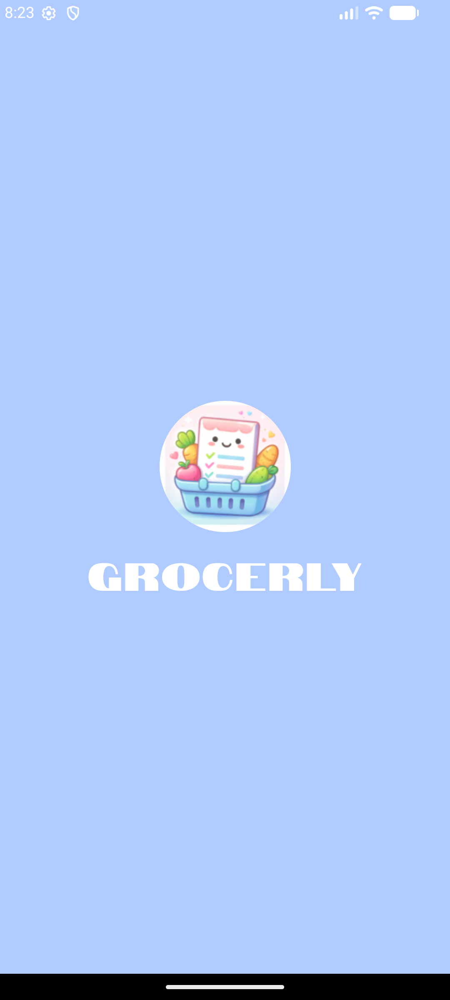
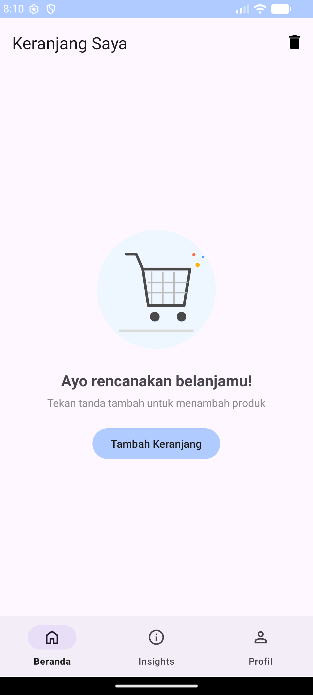
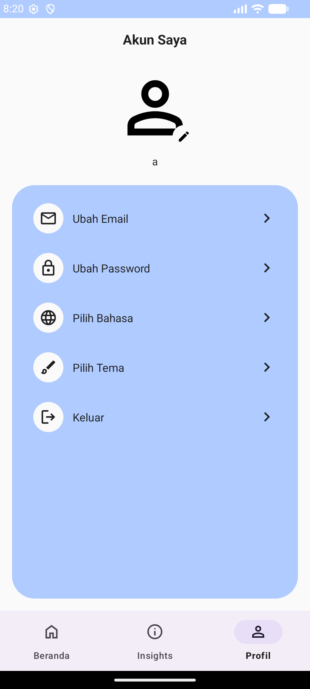
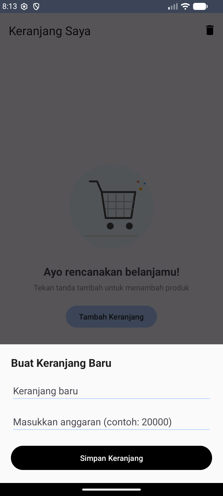
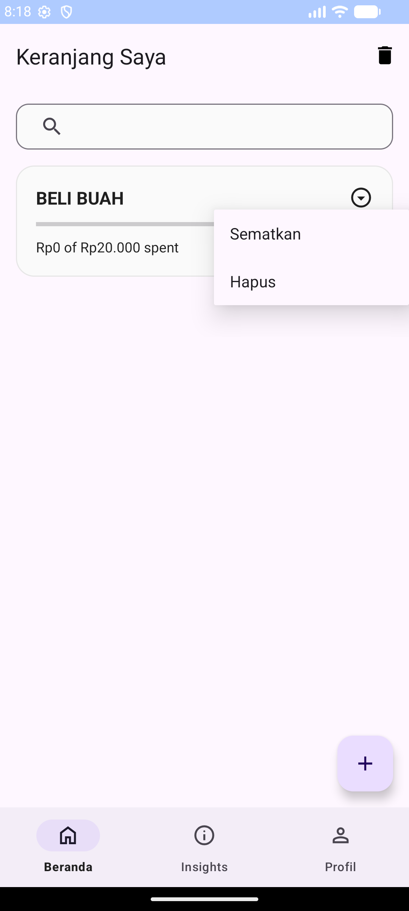
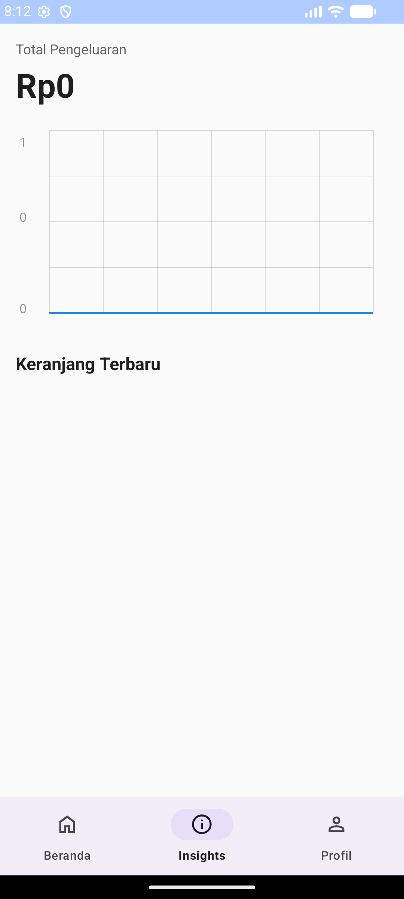

# Grocerly

**Grocerly** is an Android application designed to help users manage their grocery shopping lists efficiently. Track items, set budgets, and view spending insights all in one place.



## Overview

Grocerly is a simple yet powerful tool for anyone who wants to organize their grocery shopping. Whether you're planning a weekly shop or just need a quick list, Grocerly helps you keep track of items, manage budgets, and analyze your spending patterns.

## About the Project

- **Category**: Productivity / Shopping
- **Platform**: Android (min SDK 30, target SDK 34)
- **Language**: Kotlin 2.0.21
- **Architecture**: Fragment-based with Bottom Navigation
- **Database**: Room SQLite (with auto-migrations)
- **Charts**: MPAndroidChart v3.1.0 for spending insights

## Features

- 🛒 **Create & Manage Shopping Lists**: Create multiple lists with budget limits
- 📝 **Add Items**: Add items with name, quantity, price, and unit
- 💰 **Budget Tracking**: Set budget limits per list and track spending
- 📊 **Spending Insights**: View chart analytics of your daily/weekly spending
- 📋 **Dashboard**: Overview of your shopping activity and statistics
- 👤 **Profil**: Manage user login, theme, and language settings
- 🔐 **User Authentication**: Login/guest mode support
- 🌓 **Dark Mode**: Supports system dark mode and manual theme selection
- 🌐 **Language Support**: Multiple language support (English/Indonesian)
- 📱 **Responsive UI**: Optimized for various screen sizes

## Technology Stack

| Layer | Technology |
|-------|-----------|
| **Language** | Kotlin 2.0.21 |
| **UI Framework** | Android SDK, Fragments, Bottom Navigation |
| **Architecture** | Fragment-based with Session management |
| **Database** | Room SQLite (with auto-migrations, currently at version 3) |
| **Charting** | MPAndroidChart v3.1.0 |
| **Dependency Injection** | Manual (SessionManager, AppSettings) |
| **Build System** | Gradle 8.13.2 |
| **SDK** | compileSdk 34, minSdk 30, targetSdk 34 |
| **Network** | (Not applicable - local data only) |

## Project Structure

```
grocerly-catatbelanja/
├── gradle/              # Gradle wrapper and configuration
├── .idea/               # IntelliJ IDEA project files
├── app/
│   ├── src/main/
│   │   ├── java/com/example/grocerly/
│   │   │   ├── ui/                  # Activities
│   │   │   │   ├── SplashActivity.kt
│   │   │   │   ├── MainActivity.kt
│   │   │   │   ├── LoginActivity.kt
│   │   │   │   ├── TambahActivity.kt
│   │   │   │   └── HapusActivity.kt
│   │   │   ├── fragment/            # Fragments
│   │   │   │   ├── HomeFragment.kt
│   │   │   │   ├── InsightsFragment.kt
│   │   │   │   └── ProfileFragment.kt
│   │   │   ├── data/
│   │   │   │   ├── entity/          # Room entities
│   │   │   │   │   ├── BarangEntity.kt
│   │   │   │   │   ├── ListBelanjaEntity.kt
│   │   │   │   │   ├── ItemBelanjaEntity.kt
│   │   │   │   │   └── PurchaseEntity.kt
│   │   │   │   ├── dao/             # Data Access Objects
│   │   │   │   │   ├── ListBelanjaDao.kt
│   │   │   │   │   ├── ItemBelanjaDao.kt
│   │   │   │   │   ├── PurchaseDao.kt
│   │   │   │   │   └── BarangDao.kt
│   │   │   │   └── database/        # Room database
│   │   │   │       └── AppDatabase.kt
│   │   │   ├── util/                # Utilities
│   │   │   │   ├── AppSettings.kt
│   │   │   │   └── SessionManager.kt
│   │   │   └── MainActivity.kt      # Main entry point (ui package)
│   │   ├── res/
│   │   │   ├── layout/              # XML layouts
│   │   │   ├── values/              # Resources (strings, styles)
│   │   │   ├── drawable/            # Icons and images
│   │   │   └── mipmap/              # App launcher icons
│   │   AndroidManifest.xml
│   │   build.gradle.kts
│   └── build.gradle.kts
├── build.gradle.kts           # Root project build configuration
├── settings.gradle.kts
└── gradle.properties
```

### Key Modules

- **ui**: Activities and Fragments that make up the user interface
  - **HomeFragment**: Top screen — main dashboard with shopping lists
  - **ProfileFragment**: User settings, login, theme/language
  - **InsightsFragment**: Spending charts and analytics
- **data**: Room database entities, DAOs, and database management
- **util**: Shared preferences and app settings (language, theme, login state)
- **adapter**: RecyclerView adapters for displaying lists of items

## Usage

### Getting Started

1. **Clone the repository**
   ```bash
   git clone https://github.com/AWCODE13/grocerly-catatbelanja.git
   cd grocerly-catatbelanja
   ```

2. **Open in Android Studio**
   - Open the project in Android Studio with SDK 34 support
   - The project requires JDK 17 (compatible with Kotlin 2.0.21)

3. **Build & Run**
   - Connect an Android device or start an emulator (API 30+)
   - Click the Run button in Android Studio or run:
     ```bash
     ./gradlew installDebug
     ```

### Basic Usage

- **Home Fragment (Bagian Atas)**: App starts with the home dashboard showing your shopping lists. This is the main entry point after the splash screen.
- **Create List**: Enter a list name and budget limit, then save
- **Add Items**: Select a list, add items with name, quantity, and price
- **Dashboard**: View overview of your shopping activity and statistics
- **Profil**: Manage login status, change theme (light/dark), and select language
- **Insights Fragment**: View spending charts and statistics

### Navigasi

- Use the **Bottom Navigation** to switch between:
  - **Home** — Dashboard/daftar belanja (atas)
  - **Insights** — Grafik pengeluaran
  - **Profil** — Setings akun, tema, dan bahasa

### Data Persistence

All data is stored locally using Room SQLite. The database schema includes migrations for version updates (currently at version 3).

## Screenshots

| Feature | Screenshot |
|---------|-----------|
| Home Screen (Bagian Atas) |  |
| Dashboard |  |
| Profil |  |
| Create List Dialog |  |
| Item Details |  |
| Insights Chart |  |

> **Note**: Screenshots are placeholder images. Replace with actual screenshots by adding real device captures to the `screenshots/` directory.

## License

This project is open source and available under the [MIT License](LICENSE).

## Contact

- GitHub: [@AWCODE13](https://github.com/AWCODE13)
- Project: [grocerly-catatbelanja](https://github.com/AWCODE13/grocerly-catatbelanja)